<div align="center">

# 🦜🔗 LangChain Fundamentals

### From a single LLM call to composable AI pipelines, one building block at a time

<p>
  
  
  
  
  
  
  
</p>

*My hands-on learning journal: handwritten notes turned into runnable code.*

</div>

---

## 📖 Table of Contents

- [What is LangChain?](#-what-is-langchain)
- [Learning Roadmap](#️-learning-roadmap)
- [Repository Structure](#-repository-structure)
- [1. LangChain Components](#-1-langchain-components)
- [2. Models](#-2-models)
- [3. Prompts](#-3-prompts)
- [4. Structured Output](#-4-structured-output)
- [5. Output Parsers](#-5-output-parsers)
- [6. Chains](#-6-chains)
- [7. Runnables: The Why & The What](#-7-runnables-the-why--the-what)
- [8. LCEL & Runnable Primitives](#-8-lcel--runnable-primitives)
- [Getting Started](#-getting-started)
- [Acknowledgements](#-acknowledgements)

---

## 🤔 What is LangChain?

> **LangChain** is an open-source framework for developing applications powered by large language models (LLMs). It provides modular components and end-to-end tools for building chatbots, question-answering systems, RAG, autonomous agents, and more.

| ✨ Why LangChain? | 🏗️ What can you build? | 🔄 Alternatives |
|---|---|---|
| Supports all major LLMs | Conversational chatbots | LlamaIndex |
| Simplifies LLM-app development (**chains**) | AI knowledge assistants | Haystack |
| Integrations for all major tools | AI agents | |
| Open source, free, actively developed | Workflow automation | |
| Model-agnostic development | Summarization / research helpers | |
| Memory & state handling | | |

### 💡 Why do we even need it? A "chat with your PDF" app

Building something like *"chat with a 1000-page book"* by hand means wiring together a lot of moving parts. LangChain gives you each part as a plug-and-play component:

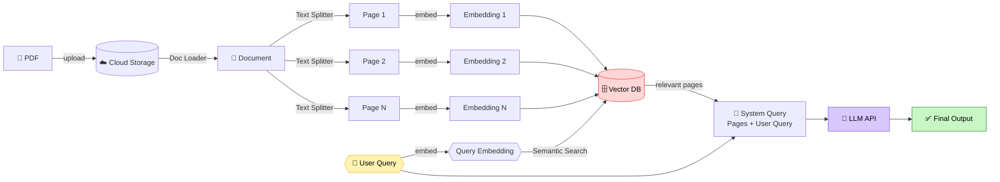

> **Semantic search** turns text into vectors (embeddings) and finds the paragraphs whose vectors point in the most similar direction to the query, e.g. *"How many runs has Virat scored?"* lands closest to the *"Paragraph about Virat Kohli"*.

---

## 🗺️ Learning Roadmap

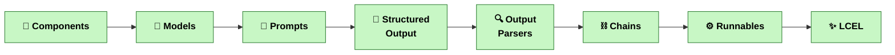

The bigger curriculum this repo sits in:

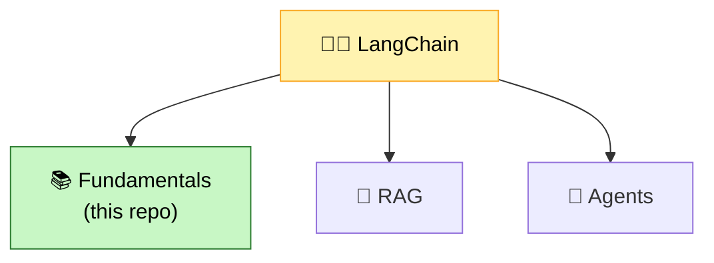

---

## 📁 Repository Structure

```
LangChain/
├── 🤖 LangChain_Models/
│   ├── LLMs/
│   │   └── LLM_Demo.py                          # Plain-text-in, plain-text-out LLM
│   ├── Chat_Models/
│   │   ├── HF_chat_model_demo.py                # HuggingFace Inference API (Qwen 2.5)
│   │   └── opensource_model_on_local.py         # Running an open-source model locally
│   └── Embedding_Models/
│       ├── opensource_embedding_model.py        # all-MiniLM-L6-v2 embeddings
│       └── document_similarity_application.py   # Cosine-similarity document search
│
├── 💬 LangChain_Prompts/
│   ├── prompt generator.py                      # Save a PromptTemplate to JSON
│   ├── dynamic_prompt_ui.py                     # Streamlit research-paper summarizer
│   ├── dynamic_prompts/first_dynamic_prompt.json
│   ├── messages.py                              # System / Human / AI messages
│   ├── chatbot.py                               # Console chatbot with history
│   ├── chatbot_with_ui.py                       # Streamlit chatbot
│   ├── chat_prompt_template.py                  # ChatPromptTemplate
│   ├── message_place_holder.py                  # MessagesPlaceholder + saved chat history
│   └── history.txt
│
├── 📐 LangChain_Structured_Output/
│   ├── Typed_Dict._Demo.py                      # TypedDict basics
│   ├── TypedDict_Format.py                      # with_structured_output + TypedDict
│   ├── Pydantic_Format.py                       # with_structured_output + Pydantic
│   ├── JSON_Format.py                           # with_structured_output + JSON Schema
│   └── About_Structured_OutPut.txt
│
├── 🔍 LangChain_Output_Parser/
│   ├── StrOutPutParser.py
│   ├── JSONOutPutParser.py
│   ├── StucturedOutPutParser.py
│   ├── PydanticOutputParser.py
│   └── About_Output_Parser.txt
│
├── ⛓️ LangChain_Chains/
│   ├── Simple_Chain.py                          # prompt | llm | parser
│   ├── Long_Sequential_Chain.py                 # topic → report → summary
│   ├── parallel_chains.py                       # notes + quiz in parallel, then merge
│   ├── Parallel_Chains_2.py                     # different input per branch
│   ├── Conditional_Chain.py                     # sentiment-based routing
│   └── Notes.txt
│
├── ⚙️ LangChain_Runnable_Primitives/
│   ├── runnable_sequence.py
│   ├── runnable_parallel.py
│   ├── runnable_passthrough.py
│   ├── runnable_lambda.py
│   └── runnable_branch.py
│
├── 🕰️ LangChain_Old_Components/               # How chains worked before Runnables
│   ├── langchain-aam-zindagi.ipynb
│   └── langchain-mentos-zindagi.ipynb
│
└── requirements.txt
```

---

## 🧩 1. LangChain Components

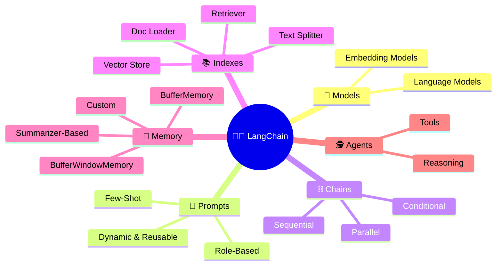

| Component | One-liner |
|---|---|
| **Models** | A uniform interface to every AI provider. Switch OpenAI → Claude → Gemini by changing one line. |
| **Prompts** | The input you send to the LLM. Templates make prompts dynamic and reusable. |
| **Chains** | Pipelines where the output of one step automatically becomes the input of the next. |
| **Indexes** | Connect your app to external knowledge such as PDFs, websites, or databases. |
| **Memory** | LLM API calls are **stateless**. Memory makes *"How old is **he**?"* work after *"Who is Narendra Modi?"* |
| **Agents** | A chatbot with superpowers: **reasoning** (chain of thought) + **tools** (calculator, weather API, …). |

<details>
<summary><b>🕵️ How an agent answers "Multiply today's temperature in Delhi by 3"</b></summary>

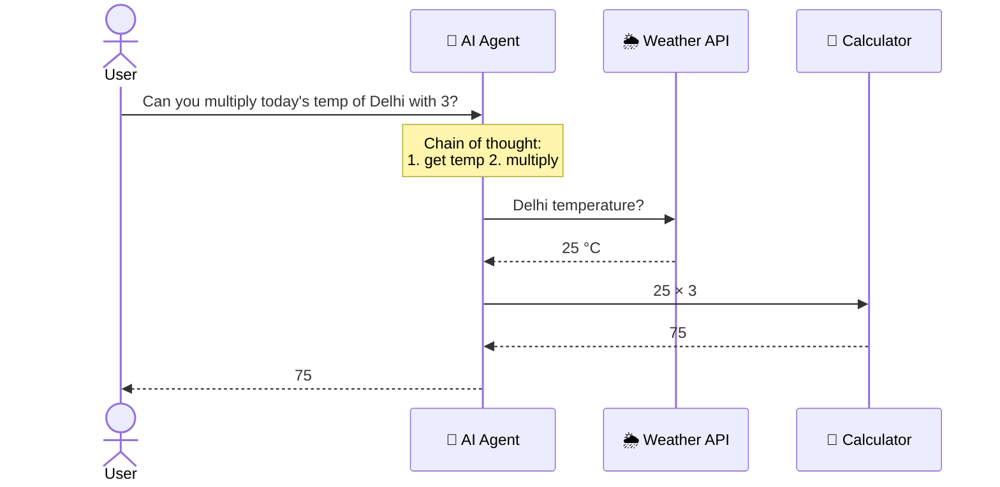
</details>

---

## 🤖 2. Models

> The Model component abstracts the complexity of working with different LLMs, chat models, and embedding models behind **one uniform interface**.

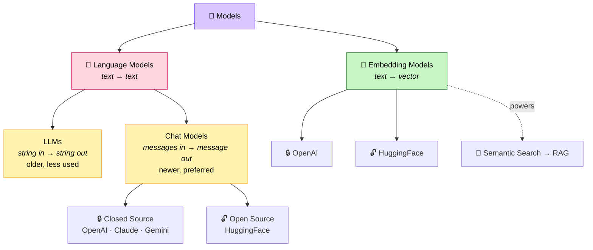

### LLMs vs Chat Models

| Feature | LLMs (Base Models) | Chat Models (Instruction-Tuned) |
|---|---|---|
| **Purpose** | Free-form text generation | Optimized for multi-turn conversations |
| **Training data** | General text corpora | Fine-tuned on chat datasets |
| **Memory & context** | No built-in memory | Supports structured conversation history |
| **Role awareness** | ❌ | Understands `system`, `user`, `assistant` |
| **Examples** | GPT-3, Llama-2-7B, Mistral-7B | GPT-4, Claude, Gemini, Llama-2-Chat |

### 🌡️ Temperature cheat-sheet

| Use case | Temperature |
|---|---|
| Factual answers (math, code, facts) | `0.0 – 0.3` |
| Balanced responses (general QA) | `0.5 – 0.7` |
| Creative writing, storytelling, jokes | `0.9 – 1.2` |
| Maximum randomness (brainstorming) | `1.5+` |

### 🔓 Open-source models: two ways to use them

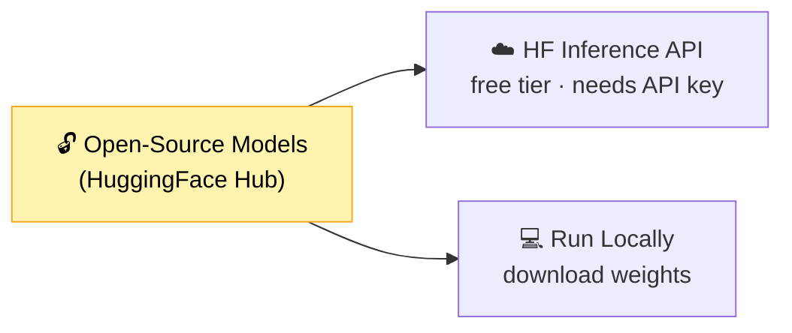

| | Open-source | Closed-source |
|---|---|---|
| 💰 Cost | Free (no API costs) | Pay per token |
| 🎛️ Control | Modify, fine-tune, deploy anywhere | Locked to the provider |
| 🔐 Privacy | Runs locally | Data sent to the provider |
| ⚠️ Downsides | Needs GPUs, complex setup, often no RLHF, limited multimodal support | — |

**In this repo:** `ChatGoogleGenerativeAI` (Gemini), `ChatGroq` (LLaMA 3.3 70B), `ChatHuggingFace` + `HuggingFaceEndpoint` (Qwen 2.5 7B), `HuggingFacePipeline` (local), and `HuggingFaceEmbeddings` (`all-MiniLM-L6-v2`) with **cosine similarity** for document search.

---

## 💬 3. Prompts

> **Prompts** are the input instructions or queries given to a model to guide its output.

### Static vs Dynamic

A static prompt lets the user type anything. A **dynamic** prompt fixes the template and only lets the user fill in the blanks, which gives consistent, controlled results. `dynamic_prompt_ui.py` builds a **research-paper summarizer** in Streamlit: pick a paper, a style (*Beginner / Technical / Code / Math*), and a length.

**Why `PromptTemplate` instead of f-strings?** ✅ default validation · ✅ reusable (save/load as JSON) · ✅ plugs into the LangChain ecosystem (chains).

### Messages & Chat Prompt Templates

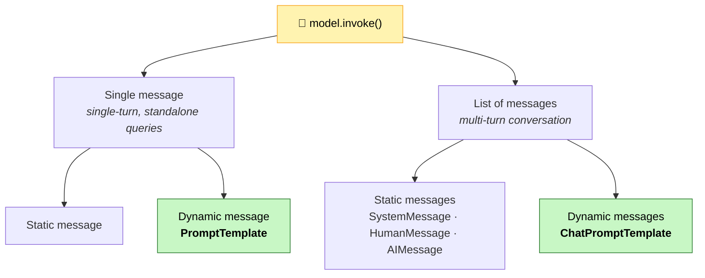

### 📌 MessagesPlaceholder

A special placeholder inside a `ChatPromptTemplate` that **injects chat history at runtime**, for example history loaded from a database or file.

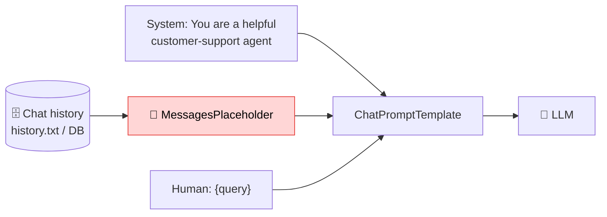

---

## 📐 4. Structured Output

> Make the LLM return a **well-defined data format** (like JSON) instead of free-form text, so its output can be consumed by **databases, APIs, and agents/tools**, not just humans.

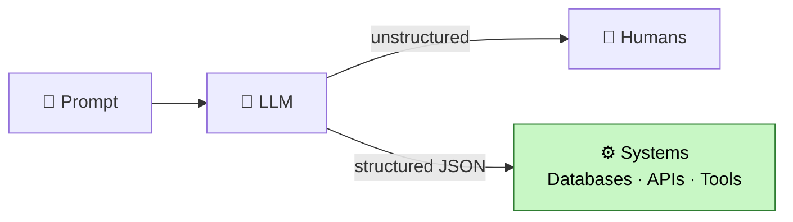

### Two ways to get it

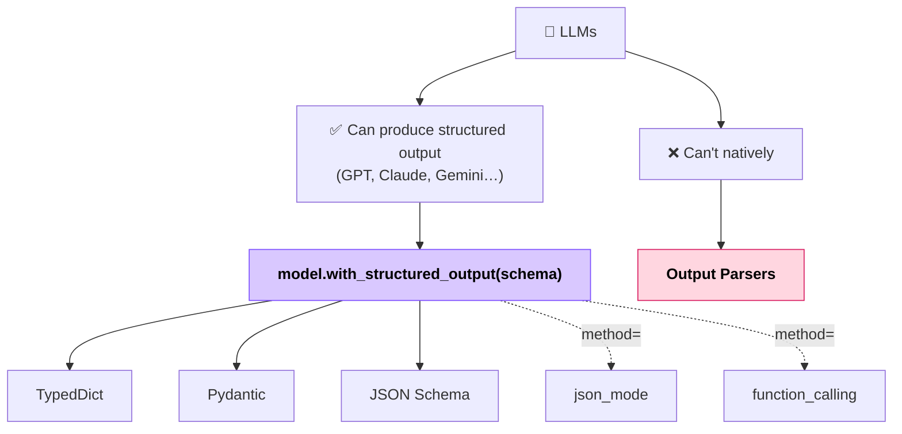

### When to use what?

| Feature | TypedDict | Pydantic 🚀 | JSON Schema 🌐 |
|---|:---:|:---:|:---:|
| Basic structure | ✅ | ✅ | ✅ |
| Type enforcement | ✅ | ✅ | ✅ |
| Data validation | ❌ | ✅ | ✅ |
| Default values | ❌ | ✅ | ❌ |
| Automatic conversion (`"100"` → `100`) | ❌ | ✅ | ❌ |
| Cross-language compatibility | ❌ | ❌ | ✅ |

- **TypedDict**: you only need type hints and trust the LLM.
- **Pydantic**: you need runtime validation, defaults, `Optional` fields, `Literal`, and `Field(...)` constraints/descriptions.
- **JSON Schema**: you don't want extra Python libraries or you work across languages.

> 💡 Example from the code: a product review → `{summary, sentiment: Literal["pos","neg"], pros, cons, ...}`

---

## 🔍 5. Output Parsers

> Output parsers convert raw LLM responses into structured formats (string, JSON, Pydantic models, …), and they work with **any** LLM, even ones that can't do structured output natively.

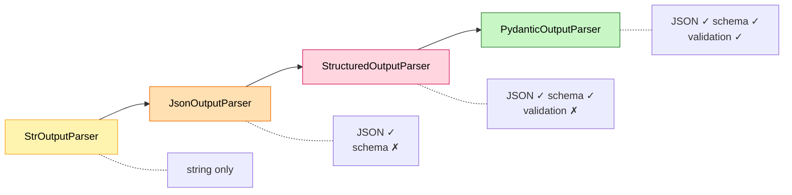

| Parser | What it does | Gotcha |
|---|---|---|
| `StrOutputParser` | Extracts `result.content` as a plain string | Its real value is in **chains**: no manual unwrapping between steps |
| `JsonOutputParser` | Returns JSON, injects `format_instructions` into the prompt | Doesn't enforce a schema |
| `StructuredOutputParser` | Enforces keys via `ResponseSchema` list | No type validation (e.g. `age: "35 years"` passes) |
| `PydanticOutputParser` | Strict schema + type safety + validation (`age > 18`) | — |

**The killer use-case for `StrOutputParser`:** one unbroken chain instead of two manual calls.

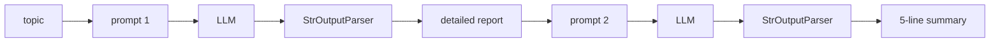

---

## ⛓️ 6. Chains

> A chain is a **pipeline**: each step's output automatically becomes the next step's input, so you call `.invoke()` once instead of wiring each step by hand.

<table>
<tr><th>➡️ Simple</th><th>🔗 Sequential</th></tr>
<tr><td>

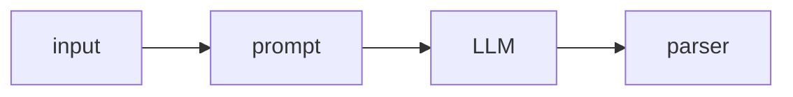

</td><td>

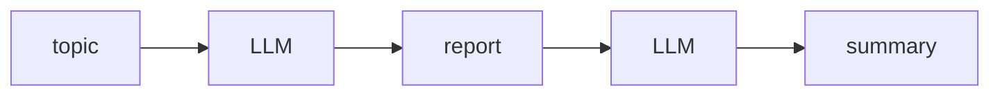

</td></tr>
</table>

### 🔀 Parallel Chain: notes + quiz from one document

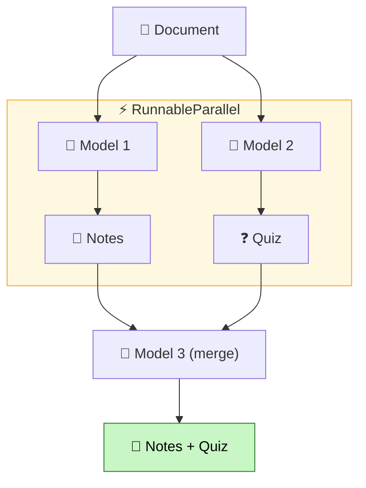

### 🚦 Conditional Chain: route customer feedback by sentiment

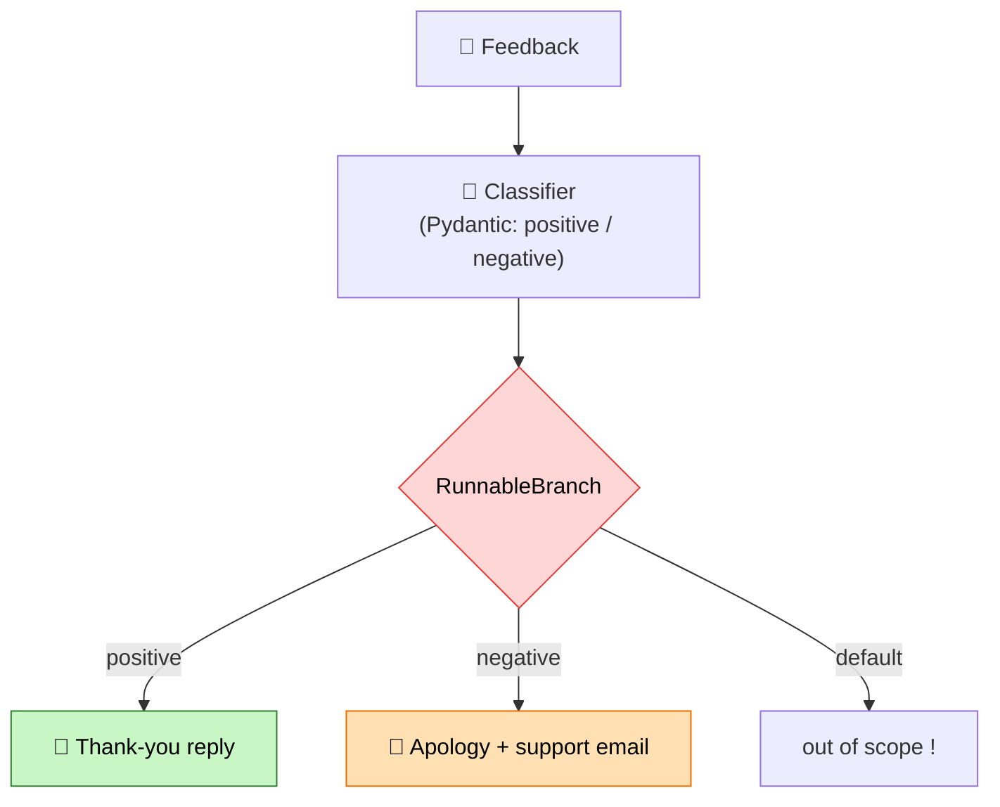

---

## ⚙️ 7. Runnables: The Why & The What

### 😵 The Why

After ChatGPT (Nov 2022), everyone wanted to build LLM apps. LangChain shipped lots of components plus a **hand-made chain for every use case**: `LLMChain`, `SequentialChain`, `RetrievalQA`, `RouterChain`, `SQLDatabaseChain`, … The result was **too many chains**, a huge codebase, and a steep learning curve for AI engineers.

The fix: give every component **one common interface** so they snap together like LEGO bricks.

### 🧱 The What

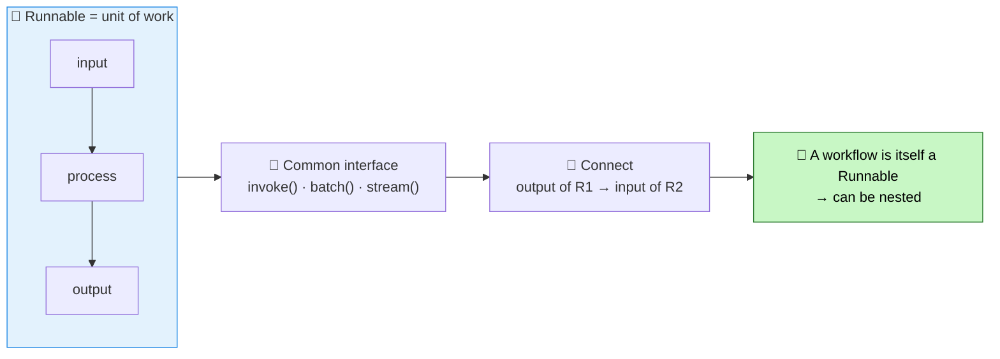

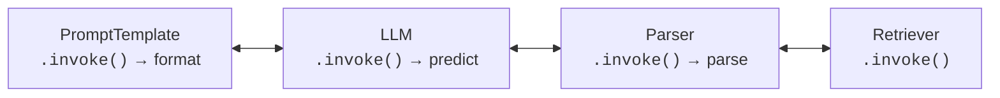

---

## ✨ 8. LCEL & Runnable Primitives

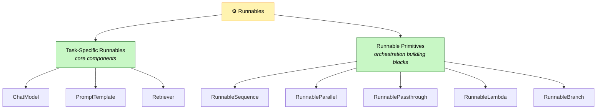

| Primitive | Analogy | Use it to… |
|---|---|---|
| `RunnableSequence` | `r1 → r2 → r3` | Run steps in order |
| `RunnableParallel` | fan-out | Run branches on the **same input**, get a dict back |
| `RunnablePassthrough` | `f(x) = x` | Forward input untouched (keep the joke *and* its explanation) |
| `RunnableLambda` | middleware | Wrap any Python function (clean text, count words, …) |
| `RunnableBranch` | `if / elif / else` | Route to different runnables based on a condition |

<details open>
<summary><b>1️⃣ RunnableSequence: prompt → joke → explanation</b></summary>

```mermaid
flowchart LR
    T["topic"] --> P1["prompt"] --> L1["LLM"] --> S1["parser"] --> P2["prompt 2"] --> L2["LLM"] --> S2["parser"] --> E["explanation"]
```
</details>

<details>
<summary><b>2️⃣ RunnableParallel: one topic → tweet + LinkedIn post</b></summary>

```mermaid
flowchart TD
    T["topic = AI"] --> B1["prompt → LLM 1 → parser"]
    T --> B2["prompt → LLM 2 → parser"]
    B1 --> TW["🐦 tweet"]
    B2 --> LI["💼 linkedin"]
    TW & LI --> D["{ tweet: …, linkedin: … }"]
    style D fill:#c8f7c5,stroke:#2e7d32,color:#000
```
</details>

<details>
<summary><b>3️⃣ RunnablePassthrough: keep the joke and explain it</b></summary>

```mermaid
flowchart LR
    T["topic"] --> JG["joke_gen_chain<br/>prompt → llm → parser"]
    JG --> PAR{"RunnableParallel"}
    PAR --> PT["RunnablePassthrough"] --> J["😂 joke"]
    PAR --> EX["prompt 2 → llm → parser"] --> X["💡 explanation"]
    style PT fill:#e3f2fd,stroke:#1e88e5,color:#000
```
</details>

<details>
<summary><b>4️⃣ RunnableLambda: joke + word count</b></summary>

```mermaid
flowchart LR
    T["topic"] --> JG["prompt → llm → parser"]
    JG --> PAR{"RunnableParallel"}
    PAR --> PT["RunnablePassthrough"] --> J["😂 joke"]
    PAR --> RL["RunnableLambda<br/>count words"] --> W["🔢 words"]
    style RL fill:#ffe0b2,stroke:#ef6c00,color:#000
```
</details>

<details>
<summary><b>5️⃣ RunnableBranch: summarize only if the report is long</b></summary>

```mermaid
flowchart LR
    T["topic"] --> R["prompt → llm → parser<br/>(detailed report)"]
    R --> RB{"RunnableBranch"}
    RB -- "> 300 words" --> SUM["prompt → llm → parser<br/>📝 summary + word count"]
    RB -- "default" --> PR["RunnablePassthrough<br/>return as-is"]
    style RB fill:#ffd6d6,stroke:#e53935,color:#000
```
</details>

### 🎯 LCEL: the LangChain Expression Language

Because sequences are so common, LCEL replaces `RunnableSequence(...)` with the **pipe operator**:

```python
# Before
chain = RunnableSequence(prompt, llm, parser)

# After (LCEL) ✨
chain = prompt | llm | parser
```

```mermaid
flowchart LR
    A["RunnableSequence(r1, r2, r3)"] == "same thing" ==> B["r1 | r2 | r3"]
    style B fill:#c8f7c5,stroke:#2e7d32,color:#000,font-weight:bold
```

---

## 🚀 Getting Started

```bash
# 1. Clone
git clone https://github.com/Og-Brutal/langchain-learning.git
cd langchain-learning

# 2. Create & activate a virtual environment
python -m venv myvenv
source myvenv/bin/activate        # Windows: myvenv\Scripts\activate

# 3. Install dependencies
pip install -r requirements.txt
```

Create a `.env` file in the project root with the keys you need:

```env
GOOGLE_API_KEY=your_gemini_key
GROQ_API_KEY=your_groq_key
HUGGINGFACEHUB_API_TOKEN=your_hf_token
OPENAI_API_KEY=your_openai_key        # optional
ANTHROPIC_API_KEY=your_anthropic_key  # optional
```

Run any script:

```bash
python LangChain_Chains/Simple_Chain.py
streamlit run LangChain_Prompts/dynamic_prompt_ui.py
```

> 💡 Chains can print their own graph: `chain.get_graph().print_ascii()` (uses `grandalf`).

---

## 🙏 Acknowledgements

These notes and exercises follow the excellent **[CampusX](https://www.youtube.com/@campusx-official) — Generative AI using LangChain** playlist by Nitish Singh. The diagrams above are re-drawn in Mermaid from my handwritten notes.

<div align="center">

---

**⭐ If this helped you learn LangChain, consider giving the repo a star!**

*Next stop: 🔎 RAG → 🤖 Agents*

</div>
